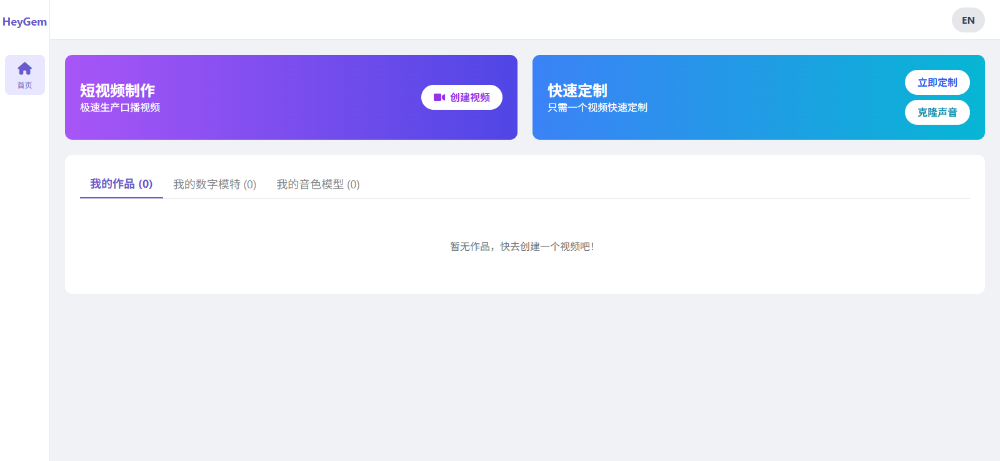
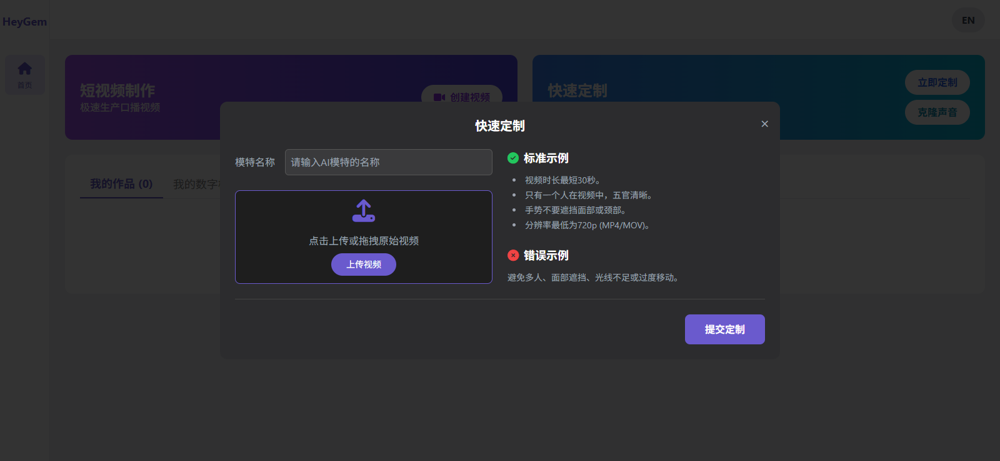
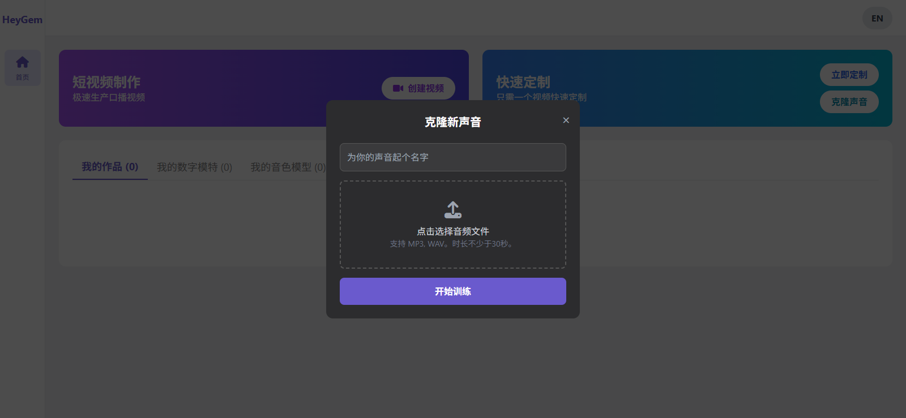
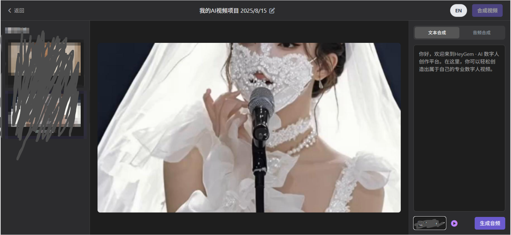
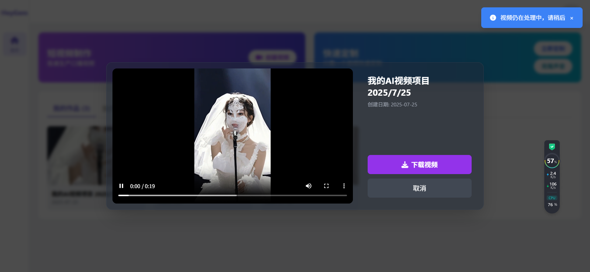

# 🌟 HeyGem AI 数字人创作平台

<div align="center">
  
  <h3>一键创建专业级数字人视频，让AI为你发声</h3>
  <p>轻松定制数字人形象 | 克隆个性化声音 | 生成逼真口播视频</p>
</div>

<div align="center">
  
  
  
  
  
</div>

## 🔥 项目亮点 | Highlights

- **零门槛创作** - 无需专业知识，3步轻松生成高质量数字人视频
- **一键克隆声音** - 仅需30秒语音样本，即可复制您的声音特征
- **极速定制形象** - 上传一段视频，快速创建个性化数字人形象
- **实时预览效果** - 所见即所得，随时调整优化创作内容
- **高度拟真合成** - 基于先进AI模型，生成逼真的口型同步和面部表情

---

- **Zero Learning Curve** - Create high-quality digital human videos in 3 simple steps
- **One-Click Voice Cloning** - Clone your voice with just a 30-second audio sample
- **Rapid Avatar Customization** - Create personalized digital humans with a single video
- **Real-time Preview** - What you see is what you get, adjust and optimize in real-time
- **Highly Realistic Synthesis** - Generate lifelike lip synchronization and facial expressions

## 📝 项目介绍 | Introduction

HeyGem AI 是一个革命性的数字人创作平台，将复杂的AI技术封装成简单易用的工具，让任何人都能轻松创建专业级数字人视频。无论是营销宣传、教育培训、内容创作，还是个人娱乐，HeyGem AI都能满足您的需求。

HeyGem AI is a revolutionary digital human creation platform that packages complex AI technology into easy-to-use tools, enabling anyone to create professional-grade digital human videos effortlessly. Whether for marketing, education, content creation, or personal entertainment, HeyGem AI meets all your needs.

## ✨ 核心功能 | Core Features

<table>
  <tr>
    <td width="50%">
      <h3>🎙️ 声音克隆</h3>
      <p>上传30秒以上的清晰语音样本，AI将分析并克隆您的声音特征，生成与您声音几乎无法区分的合成语音。支持多种语言和情感表达。</p>
      <p><i>Voice Cloning: Upload a clear voice sample of 30+ seconds, and AI will analyze and clone your voice characteristics to generate synthetic speech nearly indistinguishable from your own. Supports multiple languages and emotional expressions.</i></p>
    </td>
    <td width="50%">
      <h3>👤 数字人定制</h3>
      <p>只需上传一段包含清晰面部的视频，系统将自动提取面部特征，创建您的专属数字人形象。支持多种风格和表情定制。</p>
      <p><i>Digital Human Customization: Simply upload a video with clear facial features, and the system will automatically extract facial characteristics to create your personalized digital human avatar. Supports various styles and expression customization.</i></p>
    </td>
  </tr>
  <tr>
    <td width="50%">
      <h3>🔊 文本转语音</h3>
      <p>输入任意文本，系统将使用您克隆的声音模型，将文本转换为自然流畅的语音。支持调整语速、语调和情感色彩。</p>
      <p><i>Text-to-Speech: Input any text, and the system will use your cloned voice model to convert it into natural, fluent speech. Supports adjustments to speech rate, tone, and emotional coloring.</i></p>
    </td>
    <td width="50%">
      <h3>🎬 视频合成</h3>
      <p>将生成的语音与数字人形象结合，AI自动生成口型同步和面部表情，创造出逼真的口播视频。支持批量处理和自定义背景。</p>
      <p><i>Video Synthesis: Combine generated speech with digital human avatars, and AI automatically generates lip synchronization and facial expressions to create realistic talking head videos. Supports batch processing and custom backgrounds.</i></p>
    </td>
  </tr>
</table>

## 📸 功能展示 | Feature Showcase

<div align="center">
  <table>
    <tr>
      <td><br><center><b>主界面 | Main Interface</b></center></td>
      <td><br><center><b>数字人定制 | Avatar Customization</b></center></td>
    </tr>
    <tr>
      <td><br><center><b>声音克隆 | Voice Cloning</b></center></td>
      <td><br><center><b>视频编辑器 | Video Editor</b></center></td>
    </tr>
    <tr>
      <td><br><center><b>视频预览 | Video Preview</b></center></td>
    </tr>
  </table>
</div>

## 🛠️ 技术架构 | Technical Architecture

### 前端 | Frontend
- **React** - 构建响应式用户界面，提供流畅的交互体验
- **TailwindCSS** - 实现现代化、美观的UI设计
- **FontAwesome** - 提供丰富的图标资源

### 后端 | Backend
- **FastAPI** - 高性能Python Web框架，提供异步API支持
- **Uvicorn** - ASGI服务器，处理并发请求
- **MoviePy** - 强大的视频处理库，用于视频缩略图生成

### AI服务 | AI Services
- **语音合成服务 (TTS)** - 基于深度学习的声音克隆和合成技术
- **视频合成服务 (Face2Face)** - 基于深度学习的口型同步和面部动画生成
- **语音识别服务 (ASR)** - 用于音频转文本的高精度识别系统

## 🚀 部署指南 | Deployment Guide

### 系统要求 | System Requirements
NVIDIA GPU (推荐8GB+显存)
Docker & Docker Compose
50GB+ 磁盘空间
Ubuntu 20.04+ / CentOS 8+ / Windows 10+ 操作系统

### 硬件要求 | Hardware Requirements
CPU: 13th Generation Intel Core i5 - 13400F
Memory: 32G or more (necessary)
Graphics Card: RTX - 4070 (Ensure you have an NVIDIA graphics card and the graphics card driver is correctly installed)
Hard Disk: Free space greater than 100G

### 安装依赖 | Install Dependencies
### 方式一：Docker 一键部署 | Docker Deployment

最简单快捷的部署方式，我们已经将所有服务打包成Docker镜像，只需几个命令即可完成部署。

1. **克隆仓库 | Clone Repository**
   ```bash
   git clone https://github.com/yourusername/HeyGemWeb-client.git
   cd HeyGemWeb-client
   ```

2. **启动所有服务 | Start All Services**
   ```bash
   cd deploy
   docker-compose up -d
   ```

3. **访问应用 | Access Application**
   在浏览器中打开 http://localhost:8000
   
   Open http://localhost:8000 in your browser

### 方式二：源码部署 | Source Code Deployment

如果您需要自定义功能或进行二次开发，可以选择源码部署方式。

1. **克隆仓库 | Clone Repository**
   ```bash
   git clone https://github.com/yourusername/HeyGemWeb-client.git
   cd HeyGemWeb-client
   ```

2. **启动AI服务 | Start AI Services**
   ```bash
   cd deploy
   docker-compose up -d heygem-tts heygem-f2f heygem-asr
   ```

3. **安装后端依赖 | Install Backend Dependencies**
   ```bash
   cd ../backend
   pip install -r requirements.txt
   ```

4. **启动后端服务 | Start Backend Service**
   ```bash
   python main.py
   ```

5. **部署前端 | Deploy Frontend**
   ```bash
   cd ../web
   # 如果您使用Node.js
   npm install
   npm run dev
   # 或者直接使用任何Web服务器托管index.html
   python -m http.server 8080
   ```

6. **访问应用 | Access Application**
   在浏览器中打开 http://localhost:8080
   
   Open http://localhost:8080 in your browser

## 🧩 系统架构 | System Architecture

HeyGem AI 平台采用微服务架构，由三个核心AI服务和一个统一的Web界面组成：

```
┌─────────────────┐     ┌─────────────────┐     ┌─────────────────┐
│                 │     │                 │     │                 │
│  语音合成服务   │     │  视频合成服务   │     │  语音识别服务   │
│     (TTS)      │     │   (Face2Face)   │     │     (ASR)      │
│                 │     │                 │     │                 │
└────────┬────────┘     └────────┬────────┘     └────────┬────────┘
         │                       │                       │
         └───────────────┬───────┴───────────────┬───────┘
                         │                       │
                ┌────────┴────────┐     ┌────────┴────────┐
                │                 │     │                 │
                │   后端服务     │     │   前端界面     │
                │   (FastAPI)    │     │   (React)      │
                │                 │     │                 │
                └─────────────────┘     └─────────────────┘
```

1. **语音合成服务 (TTS)** - 负责声音克隆和文本转语音
2. **视频合成服务 (Face2Face)** - 负责数字人视频生成
3. **语音识别服务 (ASR)** - 负责音频转文本
4. **后端服务 (FastAPI)** - 协调各AI服务，处理业务逻辑
5. **前端界面 (React)** - 提供用户友好的操作界面

## 📋 API文档 | API Documentation

后端提供以下主要API端点：

| 端点 | 方法 | 描述 |
|------|------|------|
| `/api/data` | GET | 获取所有用户数据 |
| `/api/data` | POST | 保存用户数据 |
| `/api/model-training` | POST | 训练声音模型 |
| `/api/upload-avatar` | POST | 上传数字人形象 |
| `/api/audio-synthesis` | POST | 合成音频 |
| `/api/audition-voice` | POST | 试听声音 |
| `/api/video-synthesis` | POST | 合成视频 |
| `/api/batch-progress-check` | POST | 批量检查视频合成进度 |

详细API文档请参考 [接口说明/api.html](接口说明/api.html)

## 🔧 常见问题 | FAQ

**Q: 系统对上传的视频有什么要求？**  
A: 视频应包含清晰的人脸，时长不少于30秒，分辨率至少720p，格式为MP4或MOV。

**Q: 声音克隆需要多长的音频样本？**  
A: 建议提供至少30秒的清晰语音样本，样本质量越高，克隆效果越好。

**Q: 如何提高视频合成质量？**  
A: 使用高质量的原始视频素材，确保面部光线充足，避免快速移动或面部遮挡。

**Q: 支持哪些语言的文本转语音？**  
A: 目前主要支持中文和英文，其他语言正在开发中。

## 💖 支持作者

如果你觉得这个项目对你有帮助，欢迎通过下方二维码赞赏支持作者的持续开发！


## ⚠️ 免责声明

本软件仅供学习和研究使用。使用者需要：

- 遵守相关法律法规
- 尊重知识产权
- 不得用于商业用途
- 对使用本软件产生的任何后果自行承担责任

⭐ 如果这个项目对你有帮助，请给个Star支持一下！ 💡 有商业化想法？欢迎交流合作，共同探索AI写作的无限可能！