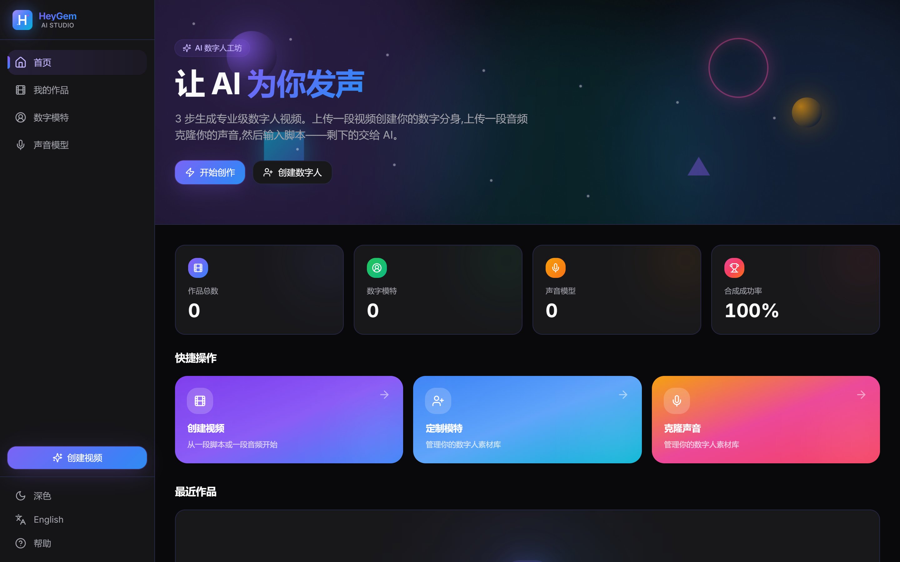
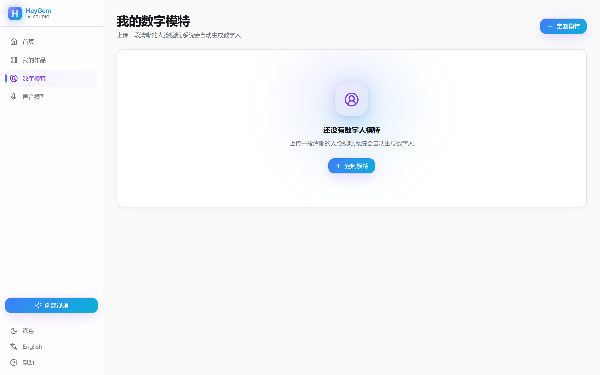
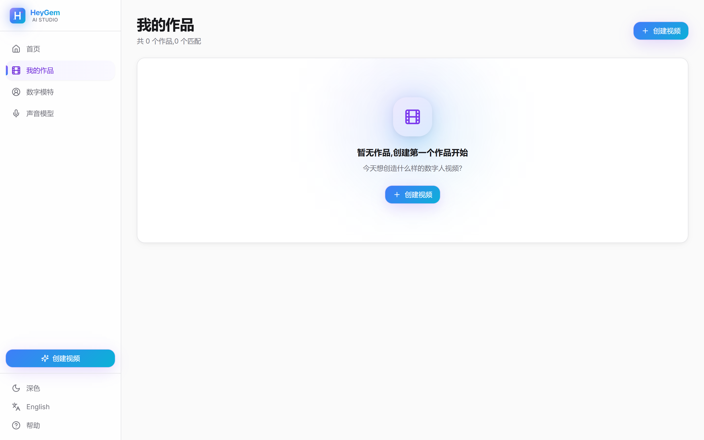

# HeyGem · AI 数字人创作平台

> 一站式 AI 数字人视频生成平台 · 3 步创建专业级口播视频

[](LICENSE)
[](https://react.dev)
[](https://www.typescriptlang.org)
[](https://vitejs.dev)
[](CONTRIBUTING.md)

HeyGem 让任何人轻松创建专业级数字人视频:上传一段人脸视频创建你的数字分身,上传一段音频克隆你的声音,然后输入脚本,AI 帮你生成带口型同步、面部表情的口播视频。



## ✨ 核心特性

- 🎭 **数字人定制** — 上传 30 秒人脸视频,生成专属数字分身
- 🎙️ **声音克隆** — 上传 30 秒音频,AI 学习你的声音特征
- ✍️ **文本转语音** — 输入任意脚本,自动生成自然口播音频
- 🎬 **视频合成** — 一键将音频 + 数字人合成完整口播视频
- 🌍 **多语言** — 内置中英双语,支持扩展
- 🎨 **现代设计** — 极光渐变 + 毛玻璃 + 微动效
- 🌓 **暗色模式** — 完整支持,跟随系统
- 📱 **PWA** — 可安装到桌面,支持离线访问
- 🌐 **i18n** — 多语言支持(中/英)

## 🖼️ 截图

| 首页(暗色) | 编辑器 | 作品列表 |
|------|--------|----------|
|  |  |  |

## 🏗️ 系统架构

```
┌─────────────────┐     ┌─────────────────┐     ┌─────────────────┐
│   语音合成服务   │     │   视频合成服务   │     │   语音识别服务   │
│     (TTS)      │     │   (Face2Face)   │     │     (ASR)      │
└────────┬────────┘     └────────┬────────┘     └────────┬────────┘
         │                       │                       │
         └───────────────┬───────┴───────────────┬───────┘
                         │                       │
                ┌────────┴────────┐     ┌────────┴────────┐
                │   后端服务     │     │   前端界面     │
                │   (FastAPI)    │     │ (React+Vite)  │
                └─────────────────┘     └─────────────────┘
```

- **前端** (`web/`) — React 18 + TypeScript + Vite + TailwindCSS + Zustand
- **后端** (`backend/`) — FastAPI + Uvicorn,负责业务编排与持久化
- **AI 服务** (`deploy/`) — 三个独立的 AI 模型服务,容器化部署

## 🚀 快速开始

### 环境要求

- **Node.js** 18+
- **后端服务**: 参见 [backend/README.md](backend/README.md)
- **AI 服务**: 参见 [deploy/README.md](deploy/README.md)

### 安装

```bash
# 1. 克隆仓库
git clone https://github.com/kele-tao/HeyGemWeb-client.git
cd HeyGemWeb-client/web

# 2. 安装依赖
npm install

# 3. 启动开发服务器
npm run dev
# 打开 http://localhost:8080
```

### 生产构建

```bash
npm run build       # 产物输出到 dist/
npm run preview     # 本地预览生产产物
```

### Docker 部署

参见 [`deploy/web.yaml`](deploy/web.yaml) — 已配置好 nginx 静态托管。

## 📖 使用文档

### 第一次使用

1. 打开网站,跟随 Onboarding 引导了解核心功能
2. 上传一段 30 秒以上的人脸视频,创建数字人
3. 上传一段 30 秒以上的音频,克隆声音
4. 进入编辑器,选数字人 + 选声音 + 写脚本
5. 一键生成口播视频,下载或分享

### 核心操作

| 操作 | 路径 | 说明 |
|------|------|------|
| 创建数字人 | 数字模特 → 定制模特 | 上传人脸视频,30秒+ |
| 克隆声音 | 声音模型 → 克隆声音 | 上传音频,30秒+ |
| 合成视频 | 首页 → 创建视频 | 选模特 + 选声音 + 写脚本 |
| 下载视频 | 作品页 → 卡片右上角下载按钮 | MP4 格式 |
| 分享视频 | 作品页 → 卡片 → 复制链接 | 公开 URL |

### 键盘快捷键

| 快捷键 | 功能 |
|--------|------|
| `g h` | 跳到首页 |
| `g w` | 跳到作品 |
| `g a` | 跳到数字模特 |
| `g v` | 跳到声音模型 |
| `g n` | 新建项目(需有数字人) |

## 🛠 技术栈

### 前端

- **[React 18](https://react.dev)** — UI 框架
- **[TypeScript 5](https://www.typescriptlang.org)** — 严格类型
- **[Vite 5](https://vitejs.dev)** — 构建工具
- **[TailwindCSS 3](https://tailwindcss.com)** — 样式
- **[Zustand](https://github.com/pmndrs/zustand)** — 状态管理
- **[React Router 6](https://reactrouter.com)** — 路由
- **[i18next](https://www.i18next.com)** — 国际化
- **[react-hot-toast](https://react-hot-toast.com)** — 通知
- **[lucide-react](https://lucide.dev)** — 图标
- **PWA** — Service Worker 离线缓存

### 后端(独立项目)

- **FastAPI** + **Uvicorn**
- **MoviePy** — 视频缩略图生成
- 三个 AI 服务容器:TTS / Face2Face / ASR

## 📁 项目结构

```
HeyGemWeb-client/
├── web/                        # 前端项目
│   ├── public/                 # 静态资源
│   ├── src/
│   │   ├── api/                # 后端 API 封装
│   │   ├── brand/              # 品牌组件(Logo / Aurora / Shapes)
│   │   ├── components/
│   │   │   ├── editor/         # 编辑器专用(WizardSteps)
│   │   │   ├── feedback/       # Modal / ErrorBoundary / Onboarding / 等
│   │   │   ├── layout/         # AppLayout / RouteGuard / HelpMenu
│   │   │   ├── modals/         # 业务模态框
│   │   │   └── works/          # 列表卡片
│   │   ├── data/               # 脚本模板数据
│   │   ├── hooks/              # 自定义 hooks
│   │   ├── i18n/               # 多语言资源
│   │   ├── lib/                # 工具函数
│   │   ├── pages/              # 5 个页面(lazy 加载)
│   │   ├── store/              # Zustand 全局状态
│   │   ├── types/              # TypeScript 类型
│   │   ├── App.tsx
│   │   ├── main.tsx
│   │   └── index.css           # Tailwind + 设计系统
│   ├── index.html
│   ├── nginx.conf              # 生产部署 nginx 配置
│   ├── package.json
│   ├── tailwind.config.js
│   ├── tsconfig.json
│   ├── vite.config.ts
│   └── README.md               # 前端详细文档
├── backend/                    # 后端项目
│   ├── main.py
│   └── requirements.txt
├── deploy/                     # 部署配置
│   ├── docker-compose.yaml
│   ├── backend.yaml
│   └── web.yaml
├── img/                        # README 配图
├── CHANGELOG.md                # 更新日志
├── CONTRIBUTING.md             # 贡献指南
├── LICENSE                     # MIT 协议
└── README.md
```

## 🤝 贡献

我们欢迎所有形式的贡献!请阅读 [CONTRIBUTING.md](CONTRIBUTING.md) 了解:

- 🐛 报告 Bug
- 💡 提出新功能
- 🔧 提交 Pull Request
- 📖 改进文档

## 📋 路线图

### 已实现

- ✅ 数字人定制(上传人脸视频)
- ✅ 声音克隆(上传音频)
- ✅ 文本转语音合成
- ✅ 视频合成(口型同步)
- ✅ 多语言(中/英)
- ✅ 暗色模式
- ✅ PWA 离线
- ✅ 路由懒加载
- ✅ 错误边界
- ✅ 客户端媒体校验
- ✅ 智能轮询进度
- ✅ 模板库(12 个场景)

### 规划中

- 📝 AI 脚本助手(LLM 集成)
- 🎵 BGM 背景音乐库
- 📊 字幕自动生成
- 👥 团队空间与协作
- 🔐 鉴权与权限系统
- 💰 计费与积分
- 📈 数据看板与分析

## 🐛 已知限制

- 无多用户/团队空间(需要后端改造)
- 无 API Key / 限流(商业版需要)
- 无计费系统
- 无审计日志
- 分享链接公开,无权限控制

## 🔒 免责声明

本软件仅供学习和研究使用。使用者需要:

- 遵守相关法律法规
- 尊重知识产权
- 不得用于商业用途
- 对使用本软件产生的任何后果自行承担责任

## 📄 许可

[MIT License](LICENSE) © 2026 HeyGem Contributors

## 🙏 致谢

- [Fish Speech](https://github.com/fishaudio/fish-speech) — TTS 引擎
- [HeyGem.ai](https://heygem.ai) — Face2Face 引擎
- [FunASR](https://github.com/modelscope/FunASR) — ASR 引擎
- [Lucide](https://lucide.dev) — 图标库
- [TailwindCSS](https://tailwindcss.com) — 样式框架

---

⭐ 如果这个项目对你有帮助,请给个 Star 支持一下!
