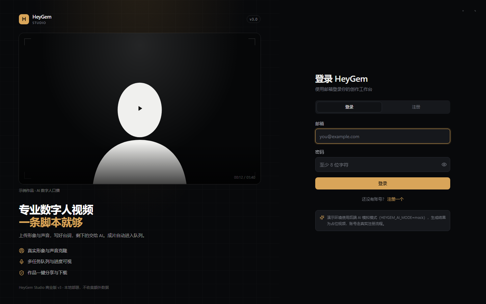
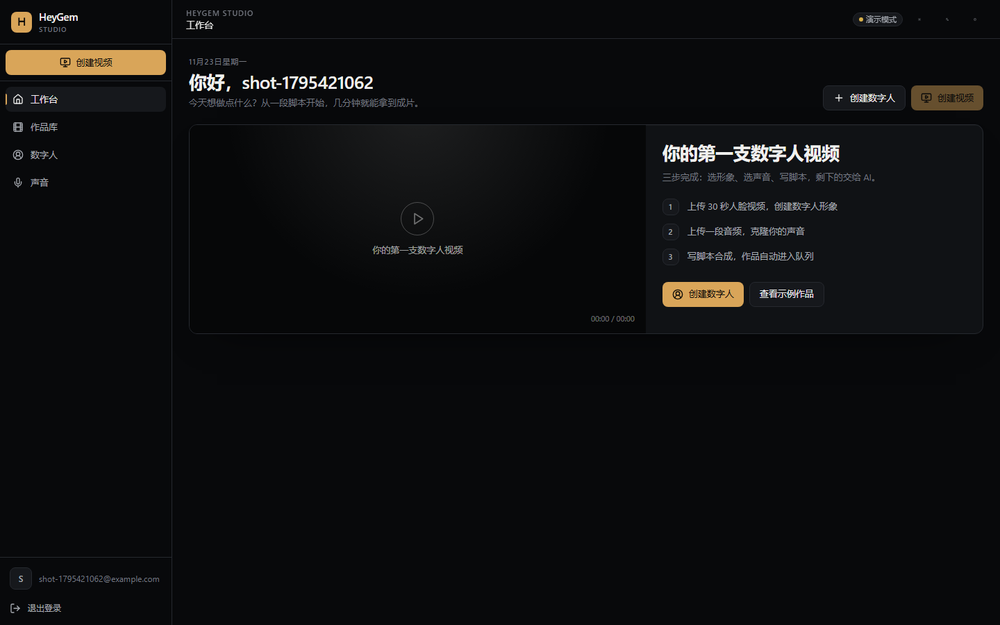
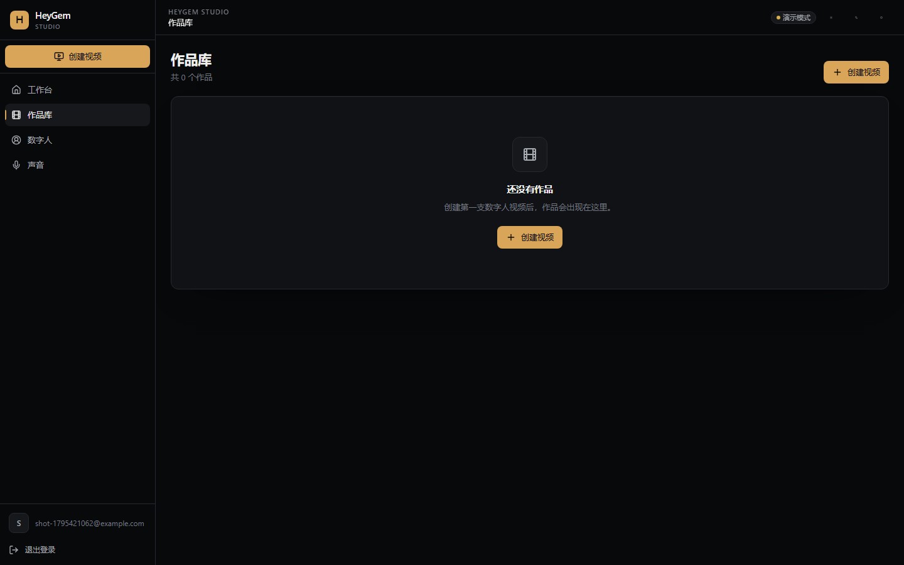
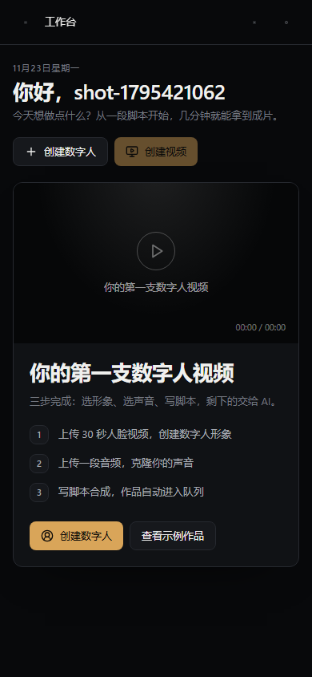
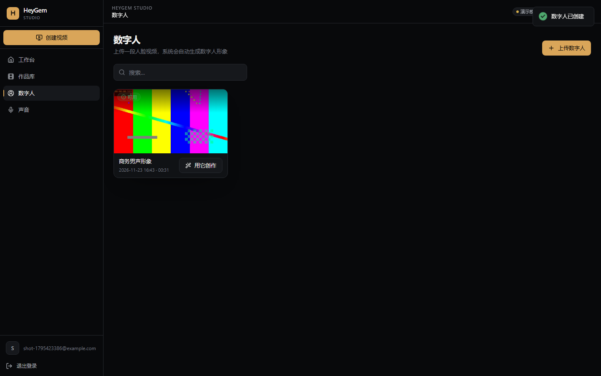

# HeyGem · AI 数字人创作平台（商业版 v3）

> 一站式 AI 数字人口播视频创作平台：上传人脸视频创建数字分身 → 上传音频克隆声音 → 写脚本 → 生成口型同步视频。
> 本轮从"单机演示版"升级为**可对外运营的商业版**：账号体系、多租户数据隔离、任务不丢、全站视觉重做。

[](LICENSE)
[](https://react.dev)
[](https://www.typescriptlang.org)
[](https://fastapi.tiangolo.com)
[](https://www.python.org)

---

## 🖼️ 界面预览

> 下列截图由 `backend/scripts/e2e_smoke.py` 与 Playwright 在真实运行环境中抓取（mock 模式）。

| 登录 / 注册 | 工作台（首跑引导） | 作品库空状态 |
|------|--------|----------|
|  |  |  |

| 移动端 390 宽 | 数字人 |
|------|--------|
|  |  |

---

## ✨ 核心特性

**产品能力**

- **账号体系（REQ-001）** — 邮箱 + 密码注册登录，注册即登录；登录态跨刷新/重开浏览器保持；退出后服务端撤销会话
- **数据私有（REQ-002）** — 单库共享表 + 行级 `user_id` 归属；跨用户访问统一返回"不存在"，不泄露资源是否存在
- **任务不丢（REQ-003/004）** — 数据库即队列；状态机 `queued → processing → success/failed`，失败可重试，服务重启后继续推进
- **完整创作链路（REQ-008/009/010/011）** — 数字人管理、声音克隆与试听缓存、四步编辑器、作品库筛选/播放/下载/分享
- **商业级视觉（REQ-005）** — 暗色影棚风（近黑中性色 + 暖铜强调色）、细边框与表面色阶分层、预览为视觉主角、浅色主题等价可用
- **可访问性（REQ-014）** — 全键盘可达与可见焦点环、弹窗焦点陷阱 + Esc 关闭、破坏性操作二次确认、三档宽度无横向滚动

**工程能力**

- FastAPI + SQLAlchemy 2 async + Alembic 单一迁移链；本地 SQLite 零配置，生产换连接串即上 PostgreSQL
- 生成任务队列：原子领取（SQLite `BEGIN IMMEDIATE` / PostgreSQL `SKIP LOCKED`）、租约心跳、超时、退避重试、重启恢复
- 文件存储全部由 `HEYGEM_DATA_ROOT` 派生，数据库只存相对路径；媒体走短时签名 URL（``/`<video>` 免请求头）
- AI 服务 `live` / `mock` 双模式：mock 可完整演示全链路，生产环境禁止 mock，**运行期绝不静默降级**
- 前端完全离线可用（不依赖任何外网 CDN / 远程字体）

---

## 🚀 快速开始（本地零配置）

### 环境要求

| 依赖 | 版本 | 说明 |
|------|------|------|
| Python | 3.11+ | 后端（本地用 SQLite，无需安装数据库） |
| Node.js | 18+ | 前端构建 |
| ffmpeg / ffprobe | 任意较新版本 | 媒体时长探测与封面抽帧；**必须**在 PATH 中 |

### 一键启动（推荐：演示模式，无需 AI 服务）

Windows PowerShell：

```powershell
# 终端 1 —— 后端（首次启动自动建库、建目录、跑迁移）
cd backend
python -m pip install -r requirements.txt
$env:HEYGEM_AI_MODE = "mock"      # 演示模式：AI 产物使用内置占位素材
python main.py                    # → http://127.0.0.1:8000  （接口文档 /docs）

# 终端 2 —— 前端
cd web
npm install
npm run dev                       # → http://localhost:8080  （/api 代理到 8000）
```

macOS / Linux：

```bash
cd backend && python -m pip install -r requirements.txt
HEYGEM_AI_MODE=mock python main.py
# 另一个终端
cd web && npm install && npm run dev
```

打开 <http://localhost:8080> → 注册一个邮箱账号 → 进入工作台。
演示模式下上传素材会走**真实的队列与状态机**，只有"AI 计算"这一步替换为占位产物（成品是 4 秒测试片）。

### 接真实 AI 服务

1. 按 [deploy/README.md](deploy/README.md) 启动 TTS(18180) / Face2Face(8383) / ASR(10095)；
2. 后端去掉 `HEYGEM_AI_MODE=mock`（默认即 `live`），并按需设置 `HEYGEM_TTS_BASE_URL` / `HEYGEM_F2F_BASE_URL`；
3. `HEYGEM_TTS_HANDOFF_DIR` / `HEYGEM_F2F_HANDOFF_DIR` 必须与 AI 容器的 `/code/data` 指向同一目录（共享目录交换是 AI 集成的硬约束）。

### 生产构建

```bash
cd web && npm run build      # 产物 dist/（tsc 严格类型检查 + vite 构建）
cd deploy && docker compose up -d
```

> 生产必须设置 `HEYGEM_JWT_SECRET`，且 `HEYGEM_AI_MODE` 保持 `live`；若在 production 环境使用 mock，启动会直接失败（需显式 `HEYGEM_ALLOW_MOCK_IN_PRODUCTION=true`）。

---

## 🧪 测试

```bash
cd backend && python -m pytest -q        # 37 passed
cd web && npx tsc --noEmit               # 0 error
cd web && npm run build                  # 构建成功
```

后端用例覆盖：账号生命周期（注册/登录/刷新轮换/退出撤销/改密）、双账号越权矩阵、任务状态机与租约回收、上传格式/时长校验、mock 生成全链路、分享链接生命周期、签名 URL 过期与归属绑定、生产禁 mock 守卫。

---

## 🏗️ 系统架构

```
┌──────────────┐   HTTPS/同源   ┌────────────────────────┐
│  浏览器       │ ─────────────▶ │  nginx（前端 dist +    │
│  React SPA   │                │  /api 反代）            │
└──────────────┘                └───────────┬────────────┘
                                            │
                              ┌─────────────▼─────────────┐
                              │  后端 FastAPI（/api）      │
                              │  api → services → models  │
                              │  jobs/worker（数据库队列） │
                              └───┬─────────┬─────────────┘
                                  │         │
                     ┌────────────▼──┐  ┌───▼─────────────┐
                     │ SQLite / PG   │  │ DATA_ROOT 数据卷 │
                     │ 7 张业务表     │  │ users/ handoff/  │
                     └───────────────┘  └───┬─────────────┘
                                            │ 共享目录
                        ┌───────────────────┼───────────────────┐
                        │                   │                   │
                  TTS 18180           Face2Face 8383        ASR 10095
```

### 后端分层（`backend/app/`）

| 目录 | 职责 | 铁律 |
|------|------|------|
| `api/` | 路由、入参校验、鉴权依赖 | 不写业务规则与事务，不做文件路径拼接 |
| `services/` | 业务规则、状态机、事务边界 | 唯一允许开事务的层 |
| `models/` `schemas/` | ORM 表结构与对外 JSON | 表结构变化不直接泄漏到 API |
| `jobs/` | 队列实现、worker、任务处理器 | 处理器不接触 HTTP 上下文 |
| `ai/` | TTS / Face2Face 协议适配 + mock | 外部协议差异只出现在这里 |
| `storage.py` `security.py` `config.py` `errors.py` | 路径/签名、密码令牌、配置守卫、统一错误码 | 归属校验与路径解析的唯一入口 |

---

## 📡 API 概览

完整契约见 `ai-docs/后端设计/API_Contract/`，运行后亦可访问 `/docs`。

| 方法 | 路径 | 说明 |
|------|------|------|
| GET | `/api/system/status` | 运行环境、AI 模式、服务可达性（公开） |
| POST | `/api/auth/register` `/login` `/refresh` `/logout` | 账号（JWT + HttpOnly 刷新 Cookie） |
| GET/POST | `/api/auth/me` `/password` | 当前用户 / 改密 |
| GET | `/api/bootstrap` | 首屏聚合：用户 + 三类资源 + 统计 + 服务模式 |
| CRUD | `/api/avatars` `/api/voices` `/api/videos` | 数字人 / 声音 / 作品（资源级，无整份覆盖保存） |
| POST | `/api/voices/{id}/audition` `/speech` | 试听（按文本哈希缓存）/ 文本转语音 |
| GET | `/api/videos/progress?ids=` | 批量进度轮询（含排队位次） |
| POST/DELETE | `/api/videos/{id}/share` | 签发 / 撤销分享链接 |
| GET | `/api/media/{kind}/{id}?exp=&sig=` | 受保护媒体（短时签名，支持 Range） |
| GET | `/api/share/{token}` | 免登录播放单个作品 |

**错误响应**统一为 `{"code", "message", "request_id"}`，`message` 为可直接展示的中文文案。

---

## ⚙️ 配置（环境变量，前缀 `HEYGEM_`）

| 变量 | 默认 | 说明 |
|------|------|------|
| `APP_ENV` | `development` | `development`/`production`；决定 mock 守卫与 Cookie Secure |
| `DATA_ROOT` | `./data`（相对 backend） | 全部运行数据的唯一根目录 |
| `DATABASE_URL` | `sqlite+aiosqlite:///<DATA_ROOT>/db/app.db` | 生产可换 `postgresql+asyncpg://` |
| `JWT_SECRET` | 空（本地自动生成并存 `DATA_ROOT/.secret_key`） | **生产必填** |
| `AI_MODE` | `live` | `live` / `mock` |
| `ALLOW_MOCK_IN_PRODUCTION` | `false` | 生产显式允许 mock 的二次开关 |
| `TTS_BASE_URL` / `F2F_BASE_URL` / `ASR_BASE_URL` | 127.0.0.1 对应端口 | AI 服务地址 |
| `TTS_HANDOFF_DIR` / `F2F_HANDOFF_DIR` | `<DATA_ROOT>/handoff/{tts,f2f}` | 必须与 AI 容器 `/code/data` 同源 |
| `WORKER_ENABLED` / `WORKER_CONCURRENCY` | `true` / `1` | 多实例部署时 API 实例置 false |
| `JOB_MAX_ATTEMPTS` / `JOB_RETRY_BACKOFF_SECONDS` | `3` / `10,60,300` | 任务重试策略 |
| `JOB_TIMEOUT_{AVATAR,VOICE,VIDEO}_SECONDS` | 180 / 300 / 1800 | 单任务硬时限 |
| `CORS_ORIGINS` | `http://localhost:8080,...` | 显式白名单（禁止 `*`） |
| `MOCK_DELAY_FACTOR` | `1.0` | 演示加速（0.05 表示 20 倍速） |

---

## 📁 项目结构

```
HeyGemWeb-client/
├── web/                        # 前端 React 18 + TS + Vite
│   └── src/{api,components,hooks,i18n,pages,store,types,data}
├── backend/                    # 后端 FastAPI（商业版 v3）
│   ├── main.py                 # 应用入口（python main.py）
│   ├── app/                    # config/db/security/storage/errors/models/schemas/api/services/jobs/ai
│   ├── migrations/             # Alembic 单一迁移链
│   ├── assets/mock/            # 模拟模式占位素材（sample.wav/mp4、thumb.jpg）
│   ├── tests/                  # pytest 白盒测试
│   └── data/                   # 运行时数据根 DATA_ROOT（已被 gitignore）
├── deploy/                     # docker compose + k8s + Dockerfile + nginx
├── ai-docs/                    # 需求与设计文档（唯一事实源，本地维护）
├── CHANGELOG.md / CONTRIBUTING.md / LICENSE / README.md
└── img/
```

---

## ⌨️ 键盘快捷键

| 快捷键 | 功能 |
|--------|------|
| `g h` / `g w` / `g a` / `g v` / `g n` | 首页 / 作品 / 数字人 / 声音 / 新建创作 |
| `Esc` | 关闭当前弹窗（焦点回到触发元素） |
| `Tab` / `Shift+Tab` | 在弹窗内循环，焦点不会逃逸 |

---

## ⚠️ 已知限制

1. **分享链接是裸视频流**：`/api/share/{token}` 直接返回 mp4，没有独立的分享落地页（契约预留了 `/meta` 接口，可后续补前端 `/s/:token` 路由）。
2. **登录限流为进程内计数**：多实例部署时会退化为"每实例独立计数"，需换 Redis 才能全局生效。
3. **未做邮箱验证与找回密码**：本期无邮件服务，属于运营链路范围外。
4. **未做计费/套餐、团队协作、运营管理后台**：已在需求范围声明中排除；账号 `disabled` 状态在数据层预留但无管理接口。
5. **草稿仍存浏览器 localStorage**：作品草稿不跨设备同步（后端不参与）。
6. **AI 服务未随仓库提供**：live 模式下需自行部署 TTS/Face2Face/ASR 容器，且必须与后端共享 handoff 目录。
7. **单机 SQLite 不承担多写进程**：多实例必须切 PostgreSQL 并只保留一个 worker 实例。

---

## 🔒 安全说明

- 密码 Argon2id 哈希；刷新令牌只存 SHA-256 摘要；访问令牌 2 小时、刷新令牌 30 天并做轮换
- 退出登录 / 改密 / 账号禁用都会服务端撤销会话（不是仅前端删除令牌）
- 媒体不暴露静态目录，一律走短时签名 URL（签名绑定 `kind|resource_id|user_id|exp`）
- 用户输入（标题、名称、原始文件名）永不参与路径拼接；文件名由服务端生成

---

## 📄 许可

[MIT License](LICENSE) © 2026 HeyGem Contributors

## 🙏 致谢

[Fish Speech](https://github.com/fishaudio/fish-speech) · [HeyGem.ai](https://heygem.ai) · [FunASR](https://github.com/modelscope/FunASR) · [Lucide](https://lucide.dev) · [TailwindCSS](https://tailwindcss.com)